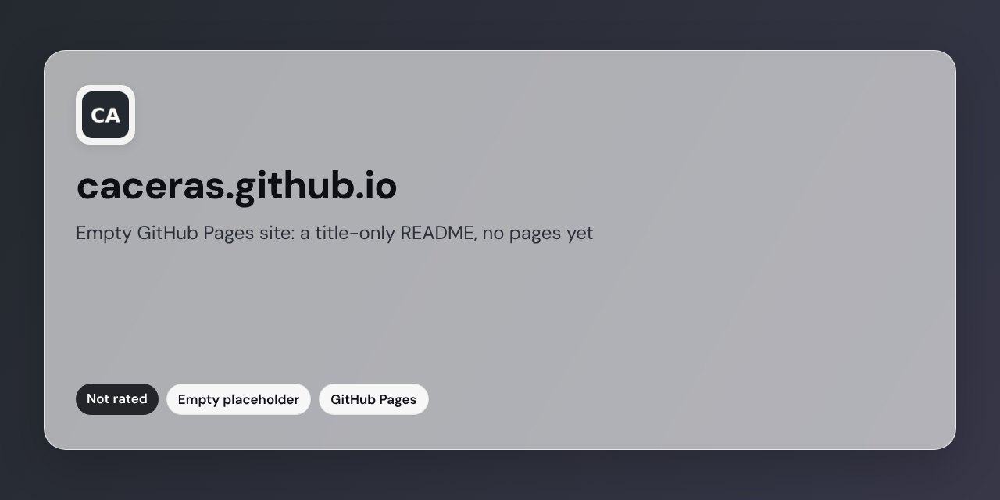

<!-- repo-card:start -->

<h2> caceras.github.io</h2>

**The personal GitHub Pages address for the Caceras account. It holds only a one-line README, so the site at caceras.github.io is an almost blank page.**

**Vision:** not written down; a GitHub Pages repo is usually meant as a personal homepage (inferred).

| | |
|---|---|
| **Status** | Empty placeholder. [caceras.github.io](https://caceras.github.io) shows only the title |
| **Code quality** | Not rated (no code) |
| **Size** | One README file |
| **Stack** | GitHub Pages |
<!-- repo-card:end -->

---

# caceras.github.io